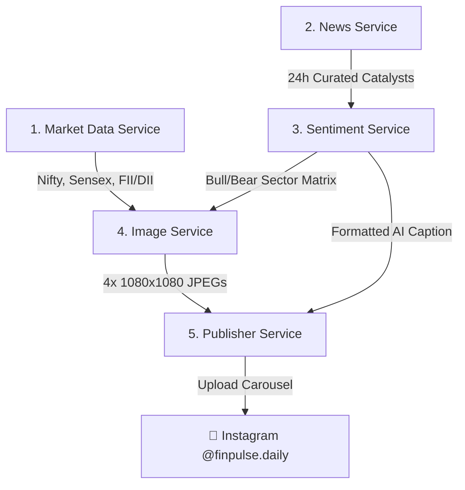

# Daily Market Intelligence Post Skill Book (1st Post)

This skill book provides a clean, end-to-end production workflow to curate, analyze, render, and publish FinPulse's premier 4-slide daily market carousel.

---

## 🏛️ Microservice Pipeline



---

## 🖼️ 4-Slide Design Architecture

1. **Slide 1: Nifty & Sensex Movement Scorecard**
   - *Background*: Deep Crimson-to-Maroon gradient (`#B91C1C` → `#450A0A`) with BSE Phiroze Towers & Wall Street exchange skyline silhouettes and candlestick watermarks.
   - *Hook*: Dynamic hook phrase (`BULLS ON RAMPAGE!`, `MOMENTUM HOLDS FIRM!`, `TIGHT ROPE ON D-STREET!`).
   - *Dynamic Mascot*: Emerald Charging Bull (`🐂 BULL POWER`) on rallies vs. Roaring Bear (`🐻 BEAR ALERT`) on corrections.
   - *Indices*: Nifty 50, Sensex, Bank Nifty, and India VIX (cooling indicator).

2. **Slide 2: Nifty Cash Inflows (Institutional Participation)**
   - *Background*: Obsidian Navy-to-Sapphire gradient (`#0F172A` → `#020617`) with technical orderbook grid.
   - *Metrics*: FII / FPI Net Flow, DII Domestic Net Flow, Total Institutional Net Balance with Bull/Bear indicator.
   - *Banner*: Amber NSE trade date ribbon.

3. **Slide 3: Market Sentiments & Sector Radar Matrix**
   - *Background*: Deep Ocean Teal gradient (`#0369A1` → `#042F2E`) with skyline texture.
   - *Metrics*: Overall sentiment gauge, India VIX assessment, 3 Bullish/Bearish Sector cards with affected tickers.

4. **Slide 4: Major Market News & Catalysts**
   - *Background*: Warm Amber-to-Sienna gradient (`#C2410C` → `#7C2D12`) with Wall Street pillar silhouettes.
   - *Content*: Top 3 breaking market developments with publisher source badges and caption link callout.

---

## 🚀 Execution Commands

### 1. Generate 4-Slide Post (CLI)
```bash
python3 main.py --generate
```

### 2. Generate and Publish to Instagram
```bash
python3 main.py --publish
```

### 3. Launch Microservice REST API
```bash
python3 main.py --api
```
*API docs available at: `http://localhost:8000/docs`*

---

## 📡 REST Endpoints
- `GET  /api/v1/market/indices` — Live Nifty, Sensex, Bank Nifty, VIX
- `GET  /api/v1/market/fii-dii` — NSE FII/DII cash market flows
- `GET  /api/v1/news/breaking` — Curated market news
- `GET  /api/v1/news/stock/{ticker}` — Past 24-hour stock news
- `POST /api/v1/post/generate` — 1-Click 4-slide carousel & caption creation
- `POST /api/v1/post/publish` — Publish directly to Instagram
