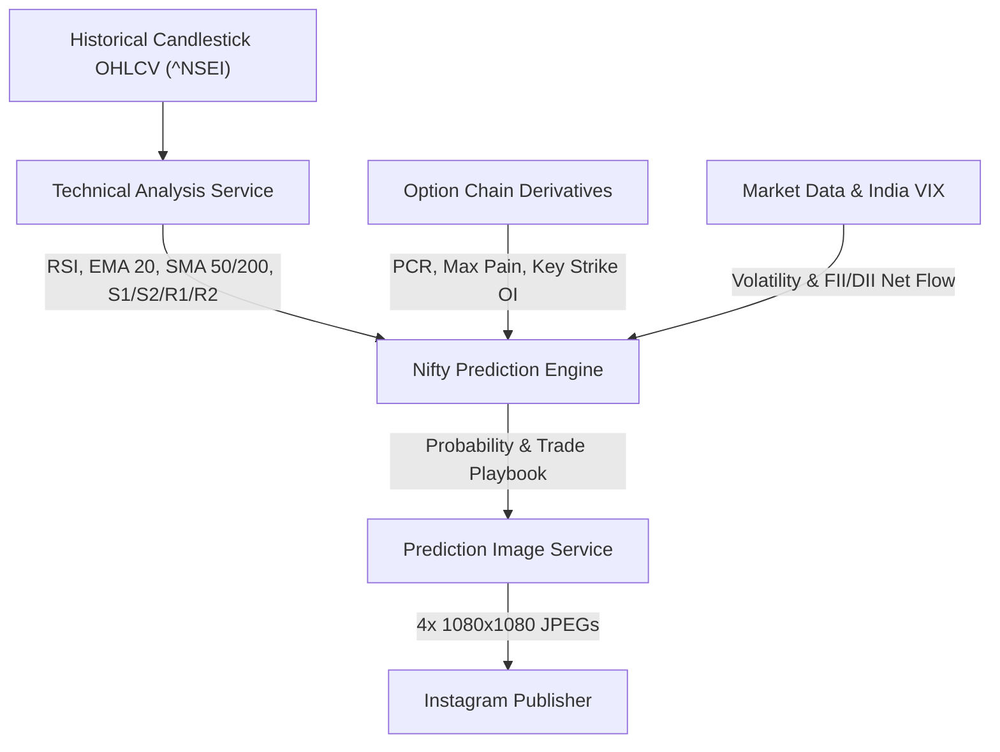

# NIFTY 50 Prediction & Technical Analysis Skill Book (2nd Post)

This skill book provides an institutional framework to formulate, render, and publish FinPulse's **NIFTY 50 Prediction & Levels Carousel**.

---

## 🏛️ Technical & Sentiment Architecture



---

## 🖼️ 4-Slide Prediction Visual Breakdown

1. **Slide 1: Nifty 50 Prediction & Target Range**
   - *Background*: Deep Crimson-to-Maroon gradient with exchange skyline & technical watermark.
   - *Hero Metrics*: Primary Trend Bias (`BULLISH ACCUMULATION / PULLBACK BUY`), Confidence Probability (`68% Probability`), Expected Session Range (`24,000 — 24,350`), and Make-or-Break Pivot.
   - *Dynamic Mascot*: Emerald Bull (`🐂`) or Roaring Bear (`🐻`).

2. **Slide 2: Technical Blueprint (Pivots & Moving Averages)**
   - *Background*: Deep Ocean Teal gradient.
   - *Metrics*: Resistances R1 & R2, Supports S1 & S2, 20 EMA / 50 SMA / 200 SMA Alignment, 14-period RSI status gauge.

3. **Slide 3: Derivatives, Option Chain & PCR Radar**
   - *Background*: Obsidian Navy-to-Sapphire gradient.
   - *Metrics*: Nifty Put-Call Ratio (PCR), Key Call Resistance Strike (Heavy Call OI), Major Put Support Strike (Put Writing Floor), Recommended Options Strategy (Bull Call Spread).

4. **Slide 4: Actionable Tactical Trade Playbook**
   - *Background*: Warm Amber-to-Sienna gradient.
   - *Plan A (Bullish Setup)*: Trigger level, Stop Loss, Target 1 & Target 2, Risk-to-Reward ratio (`1 : 2.5`).
   - *Plan B (Bearish Defense)*: Invalidation trigger, Stop Loss, Target.

---

## 🚀 Execution Commands

### 1. Generate Nifty Prediction Post (CLI)
```bash
python3 main.py --prediction
```

### 2. Generate and Publish Directly to Instagram
```bash
python3 main.py --prediction --publish
```

---

## 📡 REST API Endpoints
- `GET  /api/v1/prediction/technical` — Calculated technical indicators (Pivots, RSI, 20 EMA, 50 SMA)
- `GET  /api/v1/prediction/model` — Full prediction model & trade playbook
- `POST /api/v1/prediction/generate-post` — 1-Click 4-slide carousel & structured caption creation
